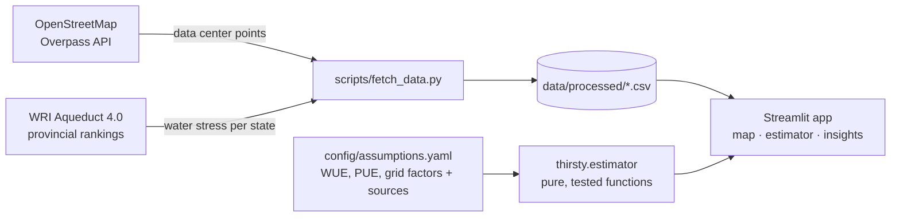

# Thirsty Compute 💧

**Where is AI thirsty?** An interactive explorer that maps US data centers onto water
stress and estimates the water footprint of a planned facility, including the upstream
water at power plants that most discussions leave out.

**Live demo:** _add your Streamlit link here_ · Built with Python, Streamlit, Plotly and public data.


---

## The problem

AI is driving a data center construction boom, and data centers consume water in two ways:

1. **Directly**, mostly through evaporative cooling on site.
2. **Indirectly**, through the power plants that generate their electricity.

Lawrence Berkeley National Laboratory estimates that US data centers directly consumed
about 17.4 billion gallons of water in 2023, and the indirect share is larger still.
At the same time, many of the fastest-growing data center markets sit in regions where
water is already scarce.

The public conversation mostly looks at one number (on-site cooling water) in isolation.
Site planners, utilities and local communities need to see **where** facilities sit
relative to water stress and **how** design choices like cooling technology shift the
footprint between the site and the grid.

## What it does

| Page | What you get |
|---|---|
| **Water risk map** | Every mapped US data center on top of WRI Aqueduct water stress per state, for today and for 2030 / 2050 / 2080 climate scenarios. |
| **Water estimator** | Enter IT capacity, utilization, cooling technology, PUE, grid water intensity and location. Get annual direct + indirect water, a household equivalent, and a scarcity-weighted figure for the chosen state. |
| **Cooling comparison** | The same site under four cooling technologies. Shows the key trade-off: dry cooling saves water on site but uses more power, so on a water-intensive grid its *total* footprint can be higher. |
| **Insights** | States ranked by "water-stress exposure" (facilities × stress score) and a scatter of data center clusters vs. water stress. |
| **Methodology** | Every formula, assumption and source, rendered from one config file. |

## How it works



**Estimator model**

```
IT energy        = capacity (MW) × 1,000 × 8,760 h × utilization
Facility energy  = IT energy × PUE
Direct water     = IT energy × site WUE              (on-site cooling)
Indirect water   = facility energy × grid water intensity   (power plants)
```

WUE follows The Green Grid definition (litres per kWh of IT energy). All defaults
live in [`config/assumptions.yaml`](config/assumptions.yaml), each with a source note, so
the model can be challenged and updated without touching code.

### Design decisions

- **Assumptions as data.** Numbers that people will argue about (WUE per cooling type,
  grid water intensity) sit in a YAML file and show up in the UI, not hidden in code.
- **Pure model, thin UI.** The estimator has no Streamlit dependency and is unit-tested,
  so it can be reused in an API or notebook.
- **Honest about gaps.** State averages, incomplete OSM coverage and count-based ranking
  are stated in the app next to the charts they affect.

## Data sources

| Dataset | Publisher | License |
|---|---|---|
| Data center locations (`telecom=data_center`, `building=data_center`) | © OpenStreetMap contributors | [ODbL 1.0](https://opendatacommons.org/licenses/odbl/1-0/) |
| [Aqueduct 4.0 Country & Provincial Rankings](https://www.wri.org/data/aqueduct-40-country-rankings) | World Resources Institute | [CC BY 4.0](https://creativecommons.org/licenses/by/4.0/) |
| [US Data Center Energy Usage Report](https://eta-publications.lbl.gov/sites/default/files/2024-12/us_data_center_energy_usage_report_lbnl-2001637.pdf) (2016, 2024) | Lawrence Berkeley National Laboratory | Public report |
| WaterSense household water use | US EPA | Public |

Aqueduct citation: Kuzma, S., et al. 2023. "Aqueduct 4.0: Updated decision-relevant global
water risk indicators." Technical Note. Washington, DC: World Resources Institute.
https://doi.org/10.46830/writn.23.00061

## Run it locally

```bash
git clone https://github.com/uelkuesara/waterusage_datacenters.git
cd waterusage_datacenters
python -m venv .venv && source .venv/bin/activate   # Windows: .venv\Scripts\activate
pip install -r requirements-dev.txt

python scripts/fetch_data.py     # downloads OSM + Aqueduct, builds data/processed/
streamlit run app.py
```

If the Aqueduct download is blocked (WRI sometimes asks for a short form), download the
country rankings manually from the [WRI page](https://www.wri.org/data/aqueduct-40-country-rankings),
put the `.zip` or `.xlsx` into `data/raw/` and run `python scripts/fetch_data.py --only aqueduct`.

Run the tests:

```bash
pytest
```

## Deploy (free)

1. Run `fetch_data.py` locally and commit the two CSVs in `data/processed/`.
2. On [Streamlit Community Cloud](https://streamlit.io/cloud), create an app from this repo with `app.py` as the entry point.
3. Paste the URL at the top of this README.

## Project structure

```
app.py                     # entry point and navigation
views/                     # one file per page
src/thirsty/
  estimator.py             # water model (pure functions)
  data.py                  # loaders + OSM / Aqueduct parsing
  states.py                # US state codes
  ui.py                    # cached loaders, shared UI bits
config/assumptions.yaml    # every model assumption, with sources
scripts/fetch_data.py      # builds data/processed/ from public sources
tests/                     # unit + app smoke tests (synthetic fixtures)
```

## Limitations & roadmap

- **Basin-level water stress.** States smooth over local hotspots; the next step is overlaying
  Aqueduct sub-basins directly.
- **Capacity weighting.** Facilities are counted, not weighted by MW. Merging capacity from
  public announcements would make the exposure ranking more meaningful.
- **Regional grid factors.** Replace the single grid water intensity with region-specific
  values (e.g. per balancing authority).
- **Projected sites.** Add PNNL's projected US data center locations to show where future
  growth meets future water stress.
- **AI site assistant.** Ask "Is Phoenix a good place for a 100 MW facility?" and get an
  answer grounded in the data above.

## About

Built by **Ülkü Sarac**. I work at the intersection of customers, product and engineering:
scoping a real-world problem, prototyping the solution and getting it deployed. My day job
is in industrial wastewater technology, which is where my interest in water as an
infrastructure constraint for AI comes from.

[LinkedIn](https://www.linkedin.com/in/) · [Website](#)

Code: MIT License. Data keeps its original licenses (see above).
